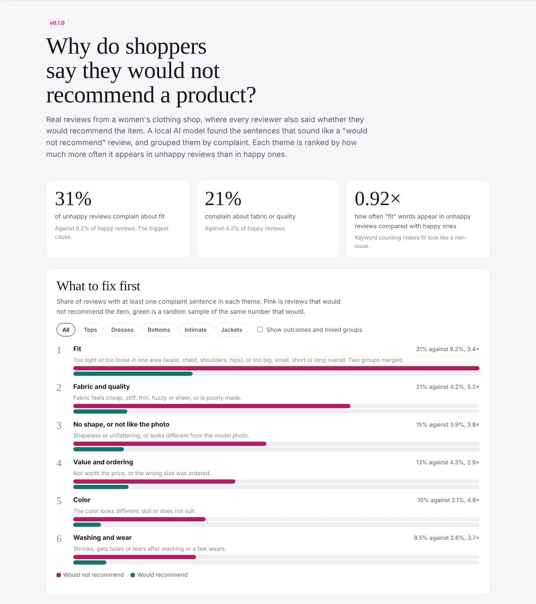

# Voice of the Customer Analyzer

**Why do shoppers say they would not recommend a product? 8,201 real clothing reviews, with the complaint sentences found and grouped by a local AI model, and compared with the keyword counting most teams start with.**

**Current version:** 0.1.0

Live results: https://kostasxeras.com/Voice-of-the-customer-analyzer/



## Why this exists

Product teams read reviews to decide what to fix. With thousands of reviews, they count keywords or read a handful. Both can mislead. Keywords count praise and complaints alike, and a handful of reviews is whatever someone happened to read.

This project uses a public dataset where every reviewer also said whether they would recommend the item. That gives a clean question: which complaints show up far more often when shoppers would not recommend?

## What it does

- Splits 4,101 "would not recommend" reviews and 4,101 random "would recommend" reviews into 38,066 sentences.
- Turns each sentence into numbers with a small AI model that runs locally (no API, no cost per call).
- Trains a simple model to spot sentences that sound like a "would not recommend" review. Each sentence is scored by a model that never saw its review.
- Groups the 9,274 sentences that score 0.7 or more into 12 groups, merged into 10 themes.
- Ranks each theme by the share of unhappy reviews that mention it, next to the share of happy reviews.
- Compares with a keyword list written before the AI grouping was run.

## Main findings

Full detail in the [case study](docs/case-study.md).

| Theme | Would not recommend | Would recommend | Ratio |
|---|---|---|---|
| Fit | 31.5% | 9.2% | 3.4× |
| Fabric and quality | 21.5% | 4.2% | 5.2× |
| No shape, or not like the photo | 14.9% | 3.9% | 3.8× |
| Value and ordering | 12.6% | 4.3% | 2.9× |
| Color | 10.2% | 2.1% | 4.8× |
| Washing and wear | 9.5% | 2.6% | 3.7× |

- **Fit is the biggest cause**, in every department (28% to 33% of unhappy reviews).
- **Keyword counting hides it.** "Fit" words appear in 47.2% of unhappy reviews and 51.1% of happy ones (0.92×), because happy reviews say "fits perfectly". A team counting keywords would put fit near the bottom of the list.
- **Fabric and quality is the most specific complaint**: 5.2 times more common in unhappy reviews.
- Theme names were written by Claude during the build, from each group's top words and example sentences. They are labels for groups, not checked categories. You can read random sentences from each group on the results page.

## Data

[Women's E-Commerce Clothing Reviews](https://www.openml.org/d/43673), 23,486 reviews, public domain (CC0). The retailer's name is replaced with "retailer" in the original data. The copy used here was downloaded from a public GitHub mirror. Reviews are cut at about 500 characters in the original data, so some quotes stop mid-word.

## My role

I framed the question, wrote the keyword list, chose the method and wrote the findings. Decisions are recorded in [docs/decisions](docs/decisions).

## Run it yourself

- **Results page:** open `index.html` through any local web server, for example `python3 -m http.server`.
- **Analysis:** put the CSV at `work/reviews.csv`, then run `npm install` and the steps in order: `npm run sentences`, `npm run embed` (about 15 minutes on a laptop CPU), `npm run model`, `npm run group`, `npm run data`. Every step is seeded, and a rerun gave identical output.

## Repo layout

```
index.html                    Results page
data/themes.json              Everything the page shows
scripts/keyword_themes.py     The keyword list (written first)
scripts/1-... to 5-...        The analysis, step by step
docs/data/                    Raw group output, including the first attempt
docs/case-study.md            Question, approach, findings, next steps
docs/product-brief.md         Users, goals, scope
docs/decisions/               One record per real trade-off
```
